# AndroidMtrls

A Jetpack Compose design system for Android 16 phones: the look and the components of an app, none
of the logic. Pre-release, so the API still moves, and not published: it's a module you build with
your app.

## Six apps

Social, Music, Photos, Calendar, Shop and Account, built from nothing but the kit. They live in the
demo app.

<p align="center">
<picture><source media="(prefers-color-scheme: dark)" srcset="screenshots/social-01-feed-dark.jpg">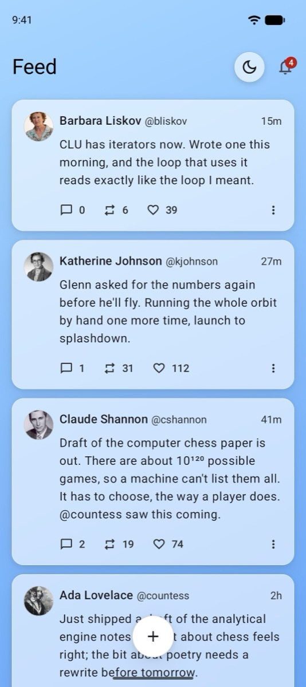</picture>
<picture><source media="(prefers-color-scheme: dark)" srcset="screenshots/music-03-album-dark.jpg">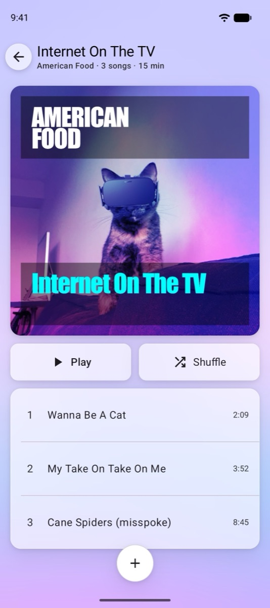</picture>
<picture><source media="(prefers-color-scheme: dark)" srcset="screenshots/photos-01-library-dark.jpg">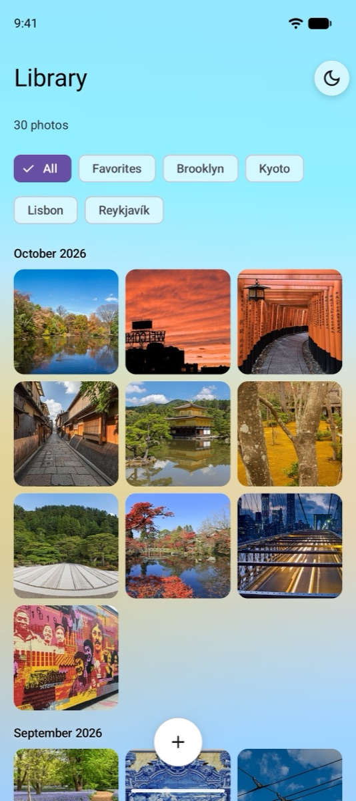</picture>
</p>
<p align="center">
<picture><source media="(prefers-color-scheme: dark)" srcset="screenshots/calendar-01-month-dark.jpg">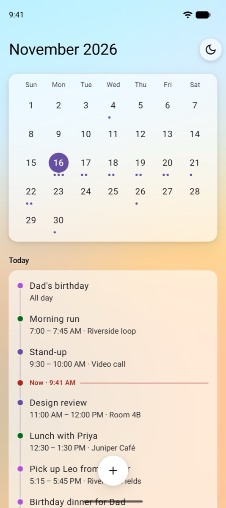</picture>
<picture><source media="(prefers-color-scheme: dark)" srcset="screenshots/shop-01-home-dark.jpg">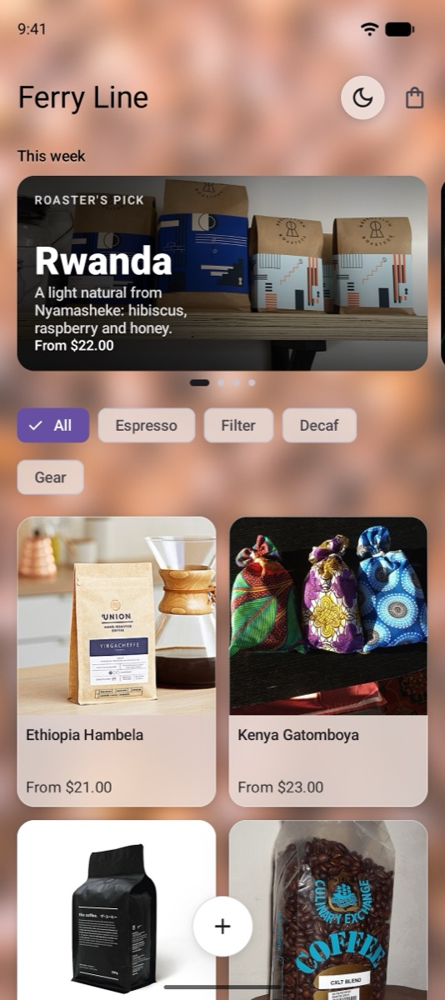</picture>
<picture><source media="(prefers-color-scheme: dark)" srcset="screenshots/account-01-intro-dark.jpg">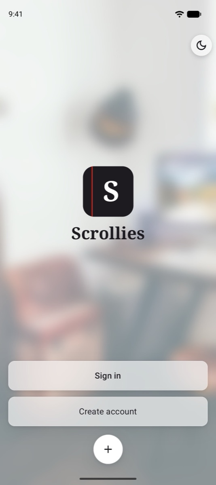</picture>
</p>

## What's different

### One + instead of tab bars

Each app keeps its navigation behind a single + button. It opens a remote: big tiles that switch
views (the current one ringed) or do something, and in Music, a working player.

<p align="center">
<picture><source media="(prefers-color-scheme: dark)" srcset="screenshots/social-00-menu-dark.jpg">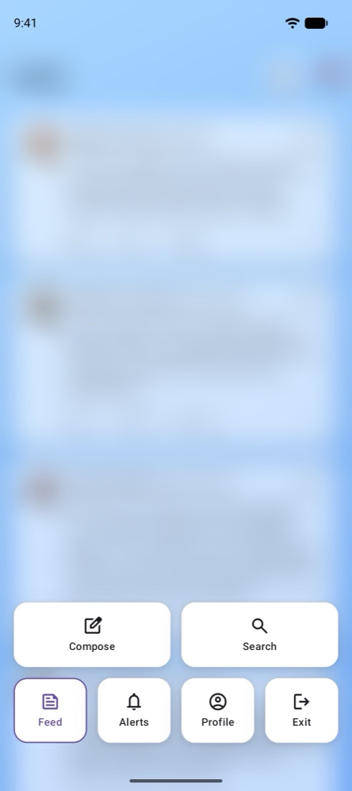</picture>
<picture><source media="(prefers-color-scheme: dark)" srcset="screenshots/music-05-menu-dark.jpg">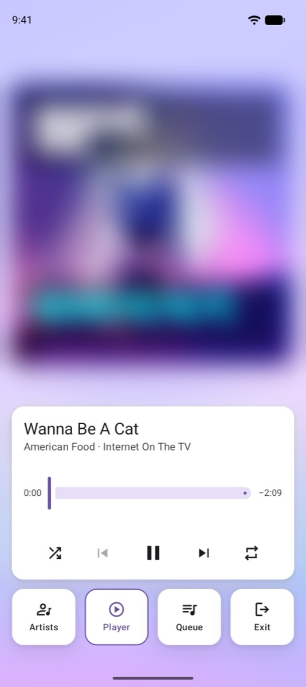</picture>
</p>

### Blur and frost, never see-through

The remote, sheets and press-and-hold menus blur the screen behind them. Flip one setting and every
surface over art turns frosted, a blur of what's behind it, while the + and the remote's tiles
always stay solid.

<p align="center">
<picture><source media="(prefers-color-scheme: dark)" srcset="screenshots/shop-02-quick-add-dark.jpg">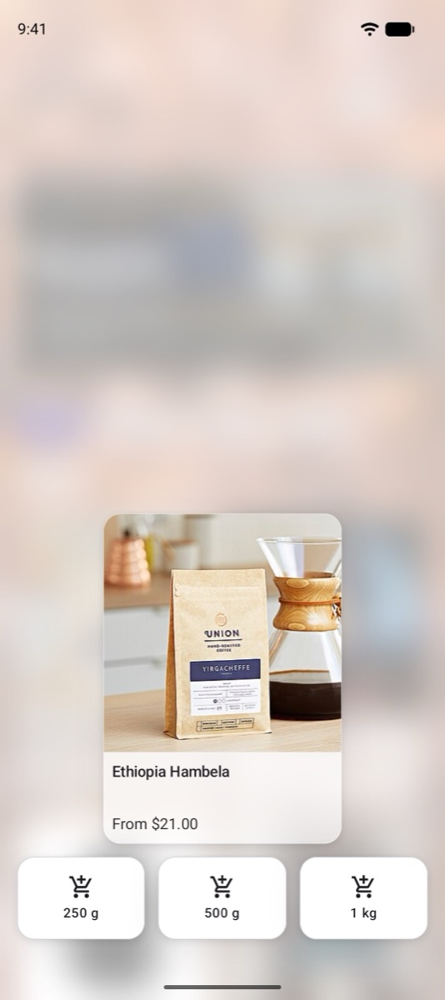</picture>
<picture><source media="(prefers-color-scheme: dark)" srcset="screenshots/photos-07-detail-dark.jpg">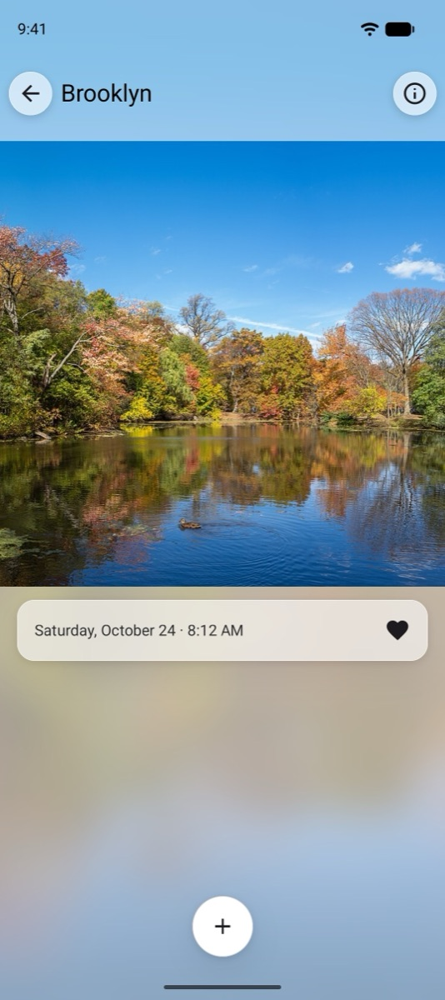</picture>
</p>

### Room to breathe

Rows run 80 dp where Material uses 56, so forms breathe and every row is easy to hit.

<p align="center">
<picture><source media="(prefers-color-scheme: dark)" srcset="screenshots/calendar-05-new-event-scrolled-dark.jpg">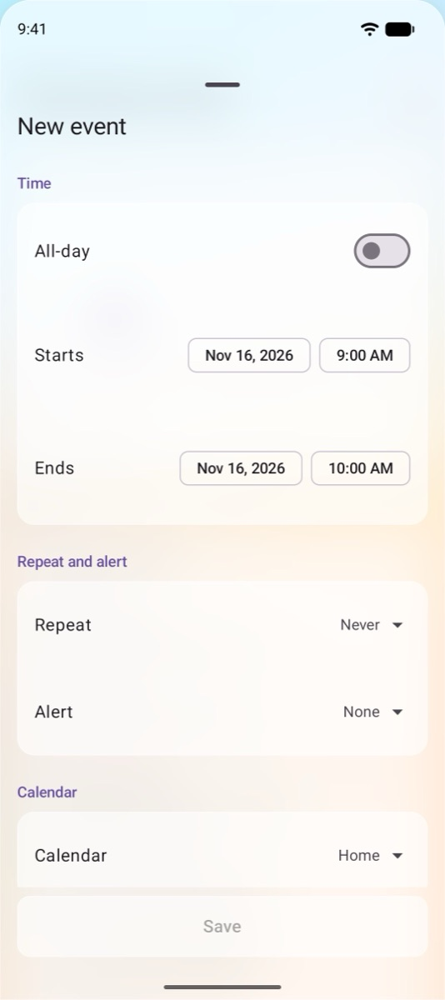</picture>
<picture><source media="(prefers-color-scheme: dark)" srcset="screenshots/account-06-settings-dark.jpg">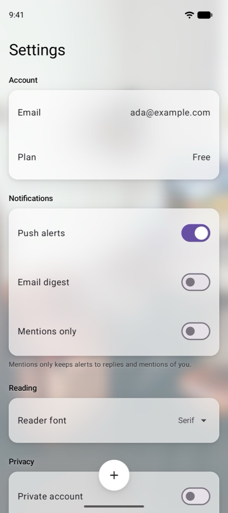</picture>
</p>

## Requirements

- Android 16 (API 36) and later
- Phones only
- The Android 37 SDK platform to build

## Install

Your app joins this Gradle build as a module beside `:androidmtrls`, the way `demo/` does:

```kotlin
// settings.gradle.kts
include(":androidmtrls")
include(":app")

// app/build.gradle.kts
plugins {
    alias(libs.plugins.android.application)  // AGP 9, with its built-in Kotlin
    alias(libs.plugins.kotlin.compose)       // the Compose compiler plugin
}

android {
    namespace = "com.example.notes"
    compileSdk = 37
    defaultConfig { minSdk = 36 }
    buildFeatures { compose = true }
}

dependencies {
    implementation(project(":androidmtrls"))  // brings Compose UI, Foundation and Material 3
    implementation(libs.androidx.activity.compose)
}
```

## Quick start

```kotlin
class MainActivity : ComponentActivity() {
    override fun onCreate(savedInstanceState: Bundle?) {
        enableEdgeToEdge()
        super.onCreate(savedInstanceState)
        setContent { AMTheme { NotesScreen() } }
    }
}

@Composable
fun NotesScreen() {
    var reminders by rememberSaveable { mutableStateOf(true) }
    val spacing = AMTheme.tokens.spacing
    Scaffold(topBar = { AMPageHeader("Notes") }, containerColor = AMTheme.Surface.page) { padding ->
        Column(
            Modifier.padding(padding).padding(horizontal = spacing.lg),
            verticalArrangement = Arrangement.spacedBy(spacing.lg),
        ) {
            Column(Modifier.fillMaxWidth().amCard()) {
                AMListRow("Harbor survey", subtitle = "Edited today")
                AMDivider(inset = spacing.lg)
                AMToggle("Remind me", checked = reminders, onCheckedChange = { reminders = it })
            }
            AMButton("New note", onClick = ::newNote, modifier = Modifier.fillMaxWidth())
        }
    }
}
```

Everything the library adds carries an `AM` prefix, or `Modifier.am…` for modifiers, so its pieces
are easy to spot beside Compose's own.

## Make it yours

```kotlin
AMTheme(colorScheme = brandColors, surfaceFill = AMSurfaceFill.Frosted) {
    NotesScreen()
}
```

Your own Material color scheme flows into every piece, and `AMSurfaceFill.Frosted` frosts the whole
app.

## Run the demo

Gradle needs three variables. Then install the demo on a phone or emulator running Android 16 or
later: a live page for every component, and the six apps under Showcase.

```bash
export JAVA_HOME="/Applications/Android Studio.app/Contents/jbr/Contents/Home" \
       ANDROID_HOME=~/Library/Android/sdk \
       GRADLE_USER_HOME="$PWD/.gradle-home"

./gradlew :demo:installDebug
```

## Build and test

From the project root, with the same three variables; the build is warning-free, and the unit tests
pin the logic that's easy to get wrong.

```bash
./gradlew :androidmtrls:assembleDebug :demo:assembleDebug           # build both modules
./gradlew :androidmtrls:testDebugUnitTest :demo:testDebugUnitTest   # the unit tests
```
